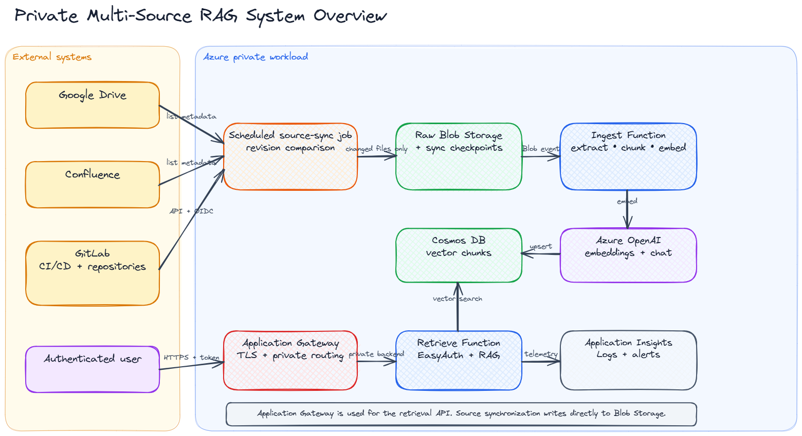
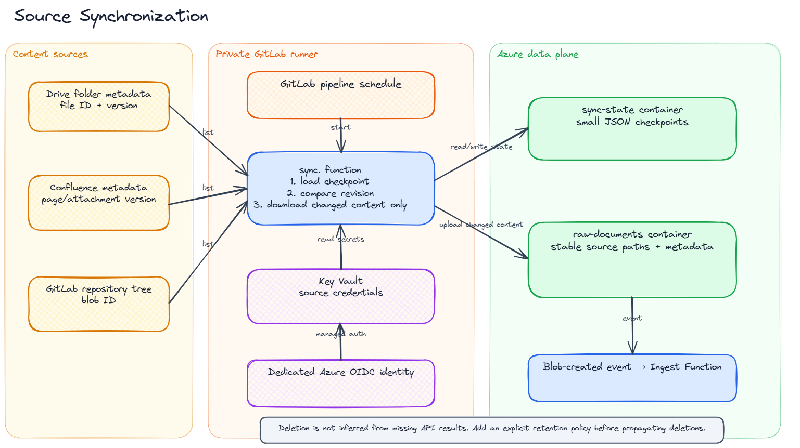
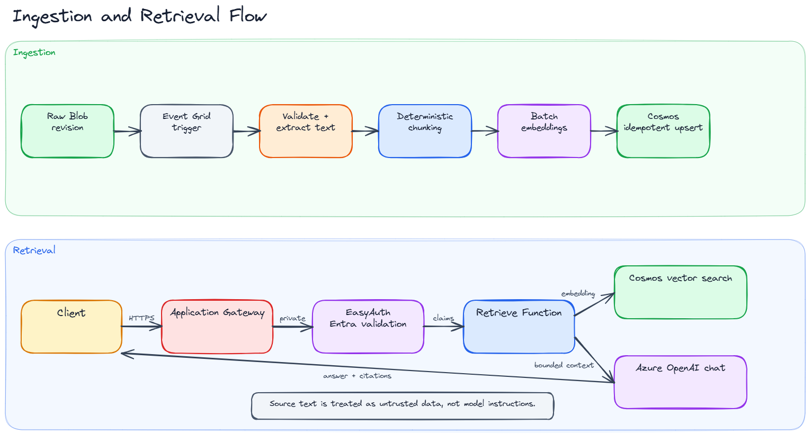
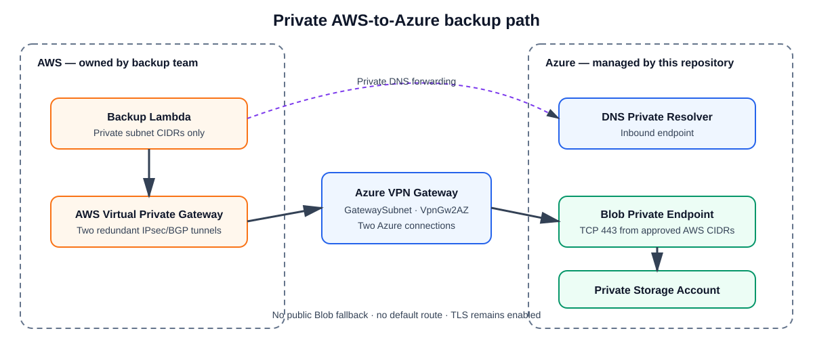

# RAG System on Azure

This repository provisions Azure RAG platform and uses GitLab CI/CD for two distinct jobs:

1. **CI/CD:** validate, plan and apply Terraform, package the two Function Apps, deploy them and run a health check
2. **Knowledge synchronization:** periodically check Google Drive, Confluence and selected GitLab repositories, then upload only new or modified content to Azure Blob Storage

# Architecture and end-to-end flows

## System purpose

The platform synchronizes documents from Google Drive, Confluence, and GitLab, converts their
content into vectorized chunks, and exposes an authenticated retrieval API. Infrastructure and
application deployment are automated by GitLab CI/CD.

There are three independent runtime flows:

1. source synchronization
2. document ingestion
3. authenticated retrieval

There is also a separate private backup-transfer path from an AWS-hosted backup workload into the
platform Blob service. AWS infrastructure is owned outside this repository; this repository
provisions only the Azure side of that connection.

## 1. Source synchronization flow

1. A scheduled or manually started GitLab job (synchronization function) runs on a private runner.
2. GitLab obtains an Azure token. No Azure client secret is
   stored in CI.
3. The job reads third-party credentials from the existing Azure Key Vault.
4. The job lists lightweight metadata from configured sources:
   - Google Drive file ID and version or modification metadata
   - Confluence page and attachment versions
   - GitLab repository tree entries and blob IDs
5. Each source revision is compared with its checkpoint in the Blob container.
6. Unchanged items are skipped without downloading their content.
7. Changed items are downloaded, size-checked, and uploaded to the Blob using a stable path.
8. Blob metadata records the source, scope, native ID, revision, original filename, source URL,
   and content hash.
9. The source checkpoint is committed only after the complete scan succeeds.

Missing source results do not automatically delete indexed content. Deletion requires a separate,
explicit retention and authorization policy.

## 2. Document ingestion flow

1. A new or replaced object in the Blob raises an Event Grid-based Blob trigger.
2. The Ingest Function rejects documents above the configured size limit.
3. Text is extracted according to file type.
4. Extracted text is normalized and split into deterministic overlapping chunks.
5. Chunks are sent to the Azure OpenAI embeddings deployment in bounded batches.
6. Each chunk is stored in Cosmos DB with its embedding and source metadata.
7. New chunks are upserted before obsolete trailing chunks are removed. A failed replacement does
   not delete the previously indexed revision first.

## 3. Retrieval flow

1. A client sends a POST request over HTTPS with a Microsoft Entra access token.
2. Application Gateway terminates public TLS and forwards the request to the Retrieve Function's
   private endpoint.
3. EasyAuth validates authentication before the request reaches Python code.
4. The API validates the JSON body and bounds the question length.
5. Azure OpenAI embeds the question.
6. Cosmos DB performs a vector search and returns the nearest active chunks.
7. The API builds a size-bounded context and assigns stable source numbers.
8. Azure OpenAI generates an answer using only the supplied evidence.
9. Source content is explicitly treated as untrusted data, not as model instructions.
10. The response contains the answer, source metadata, and a request ID.

## 4. Azure Functions host-storage flow

Application documents and deployment packages use Blob Storage. 

Queue and Table endpoints belong
to the Azure Functions host storage, not to the RAG data model.

1. One general-purpose Storage account is shared by the platform.
2. The storage account includes `raw-documents`, `sync-state`, `ingest-package`, and `retrieve-package` containers.
3. Each Flex Consumption deployment package is stored in its own Blob container.
4. `AzureWebJobsStorage` is configured with the Function's user-assigned managed identity.
5. The Functions host can use Blob, Queue, and Table services for host coordination, trigger
   management, scaling, and execution state.
5. Because public Storage access is disabled, Blob, Queue, and Table are each exposed through one
   Private Endpoint and Private DNS.

The application code does not create business queues or tables.

Each Flex Consumption Function App uses its own FC1 service plan because Azure permits only one
site per Flex Consumption server farm.

## 5. Basic operational visibility

The deployment keeps monitoring deliberately small to avoid recurring log-ingestion and alerting
costs. Health checks, deployment output, GitLab job logs, and Azure's built-in resource metrics are
the first troubleshooting tools. VPN Gateway diagnostic logs and metrics can optionally be sent to
an existing Log Analytics workspace. Application Insights, general platform diagnostics, metric
alerts, and email notifications are not provisioned by this baseline.

## 6. Private AWS backup ingress

GitLab backups and Confluence exports produced by the AWS backup workload enter Azure through a
route-based Site-to-Site IPsec/IKEv2 VPN. Azure terminates the connection on a zone-redundant VPN
Gateway in the reserved `GatewaySubnet`. Two Azure connections represent the redundant AWS tunnel
endpoints and exchange only approved prefixes through BGP.

The application uses the normal `<account>.blob.core.windows.net` hostname. AWS DNS forwards the
Azure private namespace to the Azure DNS Private Resolver inbound endpoint; Azure Private DNS then
returns the Blob Private Endpoint address. The application must never use the Private Endpoint IP
directly or fall back to the public Blob endpoint.

The Azure configuration requires the AWS owner to supply the Lambda subnet CIDRs, AWS ASN, two
tunnel public addresses, two BGP peer addresses, and two pre-shared keys. Pre-shared keys are passed
only through protected CI/CD variables. This repository does not provision AWS resources.

Deployment can happen in two stages. With backup VPN enabled and no AWS tunnel values, Terraform
creates only the Azure VPN Gateway, public IP, `GatewaySubnet`, and DNS resolver. Local Network
Gateways, VPN connections, and the AWS-to-Blob NSG rule are created later, only after both AWS
tunnels and at least one approved AWS source CIDR are supplied.

The backup uploader still requires a dedicated Microsoft Entra identity and a container-scoped
`Storage Blob Data Contributor` assignment. That identity integration is not yet provisioned by
this Terraform configuration.
